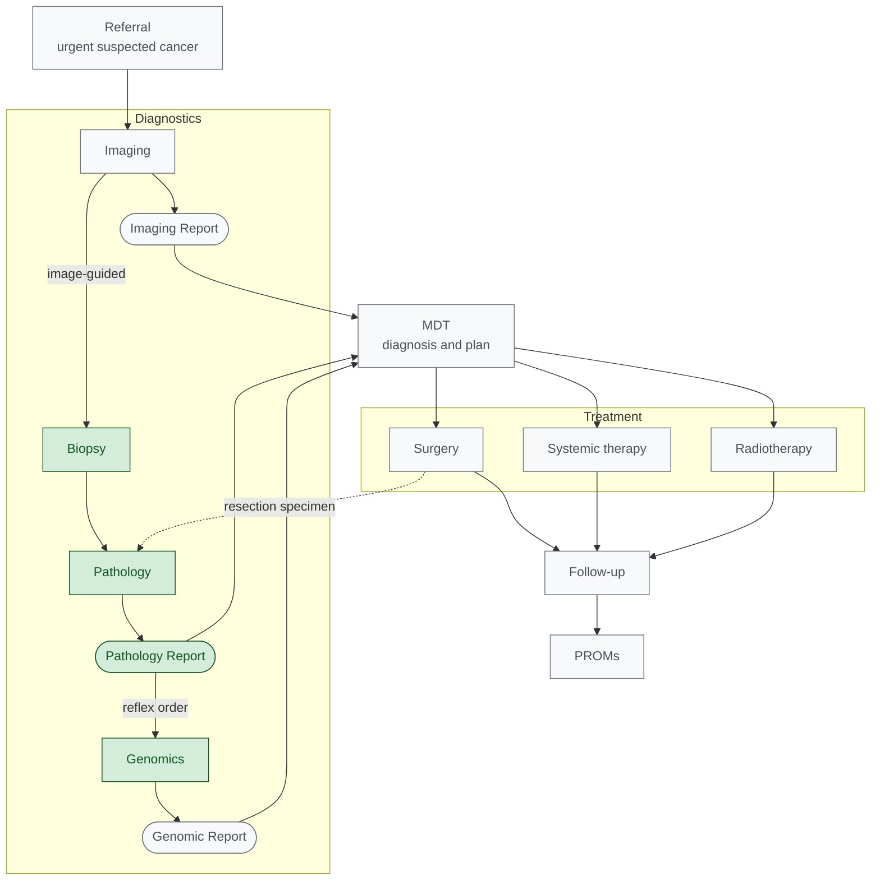
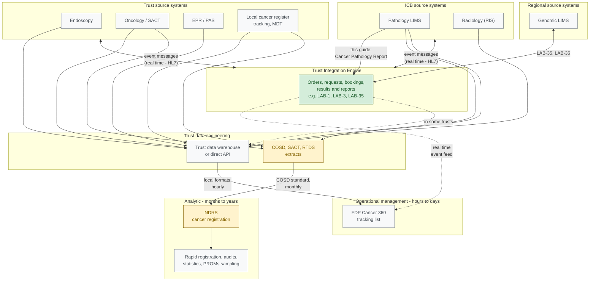

<b>Proof of concept.</b> This implementation guide is a demonstration only. It is
<b>not</b> an authoritative source, is not endorsed by NHS England, the National
Disease Registration Service or HL7, and must not be used for implementation or
clinical purposes. The authoritative source for COSD Pathology is the
<a href="https://nhsd-proxy.openprescribing.net/ndrs/data/data-sets/cosd/cosd-pathology-user-guide-v5.0/core---pathology">COSD Pathology User Guide</a>.

This page places the [Cancer Pathology Report](PathologyReport.html) in the
**whole cancer pathway**, from referral to survivorship. This guide covers the
**diagnostic** part of the pathway - pathology, and how it meets imaging and
genomics. Treatment, follow-up and patient-reported outcomes are shown for
context only: they are **out of scope**, and the national datasets and FHIR
patterns that cover them are listed so readers know where to look.

### Overview

Rectangles are activities; rounded boxes are the **reports** they produce. Each
diagnostic service produces its own report, and the MDT brings the three
together:

| Service | Report | Defined by |
|---|---|---|
| Imaging | Imaging Report | [HL7 Europe Imaging Report](https://hl7.eu/fhir/imaging/en/) - see [Imaging and Radiology](Imaging.html) |
| Pathology | Pathology Report | This guide - [Cancer Pathology Report](PathologyReport.html) |
| Genomics | Genomic Report | NW Genomics [Genomic Test Report](https://nw-gmsa.github.io/en/Questionnaire-GenomicTestReport.html) - see [Genomic Testing and Reporting](Genomics.html) |
{:.grid}

Green: covered by this guide. Grey: context only. The Pathology Report is also
the input to the genomic reflex order. The dotted line shows surgery producing a
**resection specimen**, which goes back to pathology for a further report - often
restaging the cancer (pTNM, or ypTNM after neoadjuvant therapy). Each stage is
described in [Pathway Stages](#pathway-stages) below.

### Pathway Stages

| Stage | What happens | In this guide | Workflow |
|---|---|---|---|
| Referral | Urgent suspected cancer referral, or a positive screening result | Context | - |
| Imaging | Lesion found; clinical staging (cTNM); image-guided biopsy | Context | [Imaging and Radiology](Imaging.html) |
| Biopsy / resection | Specimen taken and sent to histopathology with a request | **In scope** | [LTW](LTW.html) LAB-1 |
| Pathology | Diagnosis, grade, pathological stage, IHC; Cancer Pathology Report | **In scope** | [LTW](LTW.html) LAB-3 |
| Genomics | Reflex order from pathology; genomic report | **In scope** (as the pathology report's consumer) | [ILW](ILW.html), [Genomic Testing and Reporting](Genomics.html) |
| MDT | Imaging, pathology and genomic results combined; diagnosis, integrated stage and treatment plan | Context | - |
| Treatment | Surgery, systemic anti-cancer therapy, radiotherapy | Out of scope | - |
| Follow-up | Response to treatment, recurrence, surveillance | Out of scope | - |
| Outcomes | Patient-reported outcomes (PROMs) and experience (PREMs) | Out of scope | - |
{:.grid}

### Timing Standards

The NHS cancer waiting time standards, in force since
[1 October 2023](https://www.england.nhs.uk/wp-content/uploads/2023/08/PRN00654ii-changes-to-cancer-waiting-times-standards-from-1-october-2023-letter.pdf),
measure the pathway from referral:

| Standard | From | To | Relevance to pathology |
|---|---|---|---|
| Faster Diagnosis Standard (28 days) | Urgent referral | Cancer diagnosed or ruled out | Pathology is usually what confirms the diagnosis |
| 31 days | Decision to treat | First treatment | - |
| 62 days | Urgent suspected cancer referral, urgent screening referral or consultant upgrade | First treatment | Includes the diagnostic pathway, and any reflex genomic testing needed for the treatment decision |
{:.grid}

The [National Cancer Plan for England](https://www.gov.uk/government/collections/national-cancer-plan-for-england)
(February 2026) adds an ambition that 98% of histopathology tests are reported
within 10 days by March 2029, and that every patient who could benefit is offered
a test of their cancer's DNA - both directly affecting the diagnostic part of the
pathway.

### Outside this Guide

Where each later stage of the pathway is defined. The national datasets are
collected by the National Disease Registration Service (NDRS); the FHIR patterns
are from [mCODE](https://hl7.org/fhir/us/mcode/), which this guide is aligned with.

| Stage | National dataset | FHIR pattern (mCODE) |
|---|---|---|
| MDT and integrated stage | COSD (core and site-specific) | [Primary Cancer Condition](https://hl7.org/fhir/us/mcode/StructureDefinition-mcode-primary-cancer-condition.html), [TNM Stage Group](https://hl7.org/fhir/us/mcode/StructureDefinition-mcode-tnm-stage-group.html) |
| Surgery | COSD, [Hospital Episode Statistics](https://digital.nhs.uk/data-and-information/data-tools-and-services/data-services/hospital-episode-statistics) | [Cancer-Related Surgical Procedure](https://hl7.org/fhir/us/mcode/StructureDefinition-mcode-cancer-related-surgical-procedure.html) |
| Systemic anti-cancer therapy | [Systemic Anti-Cancer Therapy (SACT) data set](https://digital.nhs.uk/ndrs/data/data-sets/sact) | [Cancer-Related Medication Request](https://hl7.org/fhir/us/mcode/StructureDefinition-mcode-cancer-related-medication-request.html) / [Administration](https://hl7.org/fhir/us/mcode/StructureDefinition-mcode-cancer-related-medication-administration.html) |
| Radiotherapy | [Radiotherapy Data Set (RTDS)](https://digital.nhs.uk/ndrs/data/data-sets/rtds) | [Radiotherapy Course Summary](https://hl7.org/fhir/us/mcode/StructureDefinition-mcode-radiotherapy-course-summary.html) |
| Response and recurrence | COSD | [Cancer Disease Status](https://hl7.org/fhir/us/mcode/StructureDefinition-mcode-cancer-disease-status.html) |
| Patient-reported outcomes | [Cancer Quality of Life Survey](https://nhsd-proxy.openprescribing.net/ndrs/data/data-outputs/cancer-data-hub/cancer-quality-of-life-survey) | `Questionnaire` / `QuestionnaireResponse` |
| Patient experience | [National Cancer Patient Experience Survey (CPES)](https://www.ncpes.co.uk/) | - |
{:.grid}

### Operational Management (FDP Cancer 360)

Managing patients through the pathway - who is waiting, at which stage, and
against which waiting time standard - is done by cancer services managers and
tracking teams. The NHS Federated Data Platform (FDP) product **Cancer 360**
brings data from different systems into a single, automatically updated tracking
list of patients on a cancer diagnosis pathway
([Digital Health, February 2025](https://www.digitalhealth.net/2025/02/cancer-diagnostic-pathway-tool-to-launch-on-fdp/)).

<b>Terminology.</b> This guide uses three terms:
<ul>
<li><b>Clinical</b> - the care of the individual patient by clinicians: the
report reaching the EPR (LAB-3), the MDT, the reflex order to genomics (LAB-35).</li>
<li><b>Operational management</b> - managing the pathway and the service: tracking
lists, waiting time standards, bottlenecks, capacity. Cancer 360 is here.</li>
<li><b>Analytic</b> - audit, research, statistics and outcomes: NDRS.</li>
</ul>
FDP material describes Cancer 360 as supporting direct care and its data as
"operational data" (<a href="https://www.england.nhs.uk/wp-content/uploads/2025/07/redacted-cancer-360-fdp-local-dpia-v1.0.pdf">Cancer 360 local DPIA template</a>).
In clinical systems, "operational" usually means the systems clinicians use to
deliver care - EPR, LIMS, order communications - so the FDP terminology can
suggest Cancer 360 is a clinical system. It is an operational <b>management</b>
tool: it tracks the patient's progress and the actions needed, but it does not
produce or exchange the clinical reports.

The FDP Canonical Data Model overlaps with this guide in **pathway tracking and
identifiers**, not in the clinical content of the report (see the NW GMSA
[FDP Canonical Data Model](https://github.com/nw-gmsa/nw-gmsa-use-cases/blob/main/FDPCanonicalDataModel.md)
analysis):

| Area | FDP Canonical Data Model | This guide |
|---|---|---|
| Pathway | `Cancer Pathway`, `Patient Pathway`, cancer tracking comments | [Cancer Pathway](CancerPathway.html) (context) |
| MDT | `Mdt Meeting`, `Mdt Note` | Context |
| Diagnosis | `Patient Diagnosis` (SNOMED CT, ICD-10) | pCR0810, pCR6410, pCR6420 |
| Report | `Histology` - one object per discipline | [Cancer Pathology Diagnostic Report](StructureDefinition-CancerPathologyDiagnosticReport.html) |
| Results | `Test Result` - one flat row per result; no LOINC, no order object | Coded `Observation`s grouped by the report |
| Identifiers | `Test Result.Laboratory Number` | `Specimen.accessionIdentifier`, order numbers |
{:.grid}

The COSD synoptic content - histological type and grade, pTNM, margins, invasion,
tumour size, MMR IHC - has no equivalent in the FDP Canonical Data Model. What
tracking needs from the pathology report is the **milestone** (report authorised,
`DiagnosticReport.issued`, pCR0780), the diagnosis it confirms, and the
identifiers that link it to the patient's pathway.

#### Where Cancer 360 gets its data

NHS England's
[Cancer 360 local DPIA template](https://www.england.nhs.uk/wp-content/uploads/2025/07/redacted-cancer-360-fdp-local-dpia-v1.0.pdf)
(v3.0, May 2025) describes the feeds. Each trust completes it, so system names
and refresh intervals are left for the trust to fill in. Data comes from the
**trust's own systems**, through a direct API connection or the trust data
warehouse, refreshed every few hours - **not** from NDRS, and not as COSD, HL7 v2
or FHIR messages:

| Trust system | Domain | Datasets |
|---|---|---|
| Radiology Information System | **Imaging** | Radiology exams, booking status, report text |
| Histology System | **Pathology** - cellular pathology (histopathology) | Histopathology samples, histopathology diagnostic reports |
| Pathology Results System | **Pathology** - other disciplines (for example blood sciences) | Test results |
| Endoscopy Information System | Endoscopy - a diagnostic procedure; its biopsies go to pathology | Endoscopy exams, booking status, report text |
| Cancer registry (the trust's local cancer register / tracking system) | Cancer services - pathway tracking and MDT | Cancer pathways, tracking notes, MDT meetings, notes and bookings, inter-provider transfers |
| EPR | Administration and care - not diagnostic | Demographics, contact details, outpatient appointments, inpatient procedures |
| Oncology Information System | Treatment - not diagnostic | Cancer treatments, treatment booking status |
{:.grid}

Only three of the seven systems are pathology or imaging. Endoscopy is a
diagnostic service in its own right - it is reported separately, like imaging,
and produces specimens for pathology. Genomics is not listed as a source.
The diagnostic systems match the FDP Canonical Data Model objects `Radiology
Exam`, `Histology`, `Test Result` and `Endoscopy`.

Actions entered by staff in Cancer 360 (requests to teams, owners, due dates,
escalations) are not written back to the source systems. The field-level
"Cancer 360 Data Specification" is referred to but not published.

**Orders are not included.** The template lists no order or request datasets
from any source system. Order dates appear only as timing fields in its
metrics - "Mean Order Day" for radiology exams, endoscopy exams, outpatient
appointments and inpatient procedures. For histology the metrics are only
sample taken day, report day and report turnaround time, so pathology is
measured from when the sample was taken, not from the request. The "requests"
in Cancer 360 are its own actions (for example "book imaging"), created by staff
in the tool. Neither the histopathology request (LAB-1) nor a reflex order to
genomics (LAB-35) and its result (LAB-36) are visible - a patient waiting for a
reflex genomic test appears only through tracking notes or manually created
actions. This is based on the template; the unpublished Data Specification or a
trust's completed DPIA may differ.

- Whether the histopathology report reaches Cancer 360 as **structured** items or
  only as report-level data is **open**. For radiology and endoscopy the template
  says "report text".
- The trust's local cancer register is also the system trusts typically use to
  compile their COSD submission, so the diagnosis milestones Cancer 360 tracks
  already originate in the trust. A structured LAB-3 report, as in this guide,
  would be a cleaner source for them.
- NHS England reported Cancer 360 live at Chelsea and Westminster and Royal United
  Hospitals Bath, with University Hospitals of Derby and Burton implementing it and
  a further 10 trusts to follow
  ([May 2025](https://www.england.nhs.uk/long-read/nhs-expands-cancer-technology-rollout/)).

### Cancer Registration (NDRS): Analytic

The National Disease Registration Service (NDRS) receives COSD, SACT and RTDS
submissions from every trust and builds the national cancer registration. It is
an **analytic** service - for audit, research, national clinical audits, PROMs
sampling and official statistics - not a clinical or operational management one.
Its data arrives too late to support decisions on a patient's pathway:

| Stage | When it is available | Compared with the pathway |
|---|---|---|
| COSD submission by the trust | Monthly, around a month after diagnosis | After the 28-day Faster Diagnosis Standard |
| [Rapid Cancer Registration Data](https://www.natcan.org.uk/?p=1906) | Around 4 to 5 months after diagnosis, at lower quality | After the 62-day treatment standard |
| [Full cancer registration](https://www.natcan.org.uk/?p=1906) | Around 18 to 24 months after the diagnosis cohort | Around the time of the [Cancer Quality of Life Survey](#patient-reported-outcomes) |
| [Official statistics](https://nhsd-proxy.openprescribing.net/data-and-information/publications/statistical/cancer-registration-statistics/england-2023) | Around two years - for example 2023 diagnoses from an August 2025 data snapshot | Long after treatment |
{:.grid}

Clinical uses (the clinical team, the MDT, a reflex order to genomics) and
operational management (tracking against waiting time standards) need the report
when it is authorised. That is why this guide shares the report directly from
the pathology laboratory, and uses COSD only to define its content - see
[Why not use registry data?](index.html#why-not-use-registry-data).

| | Clinical | Operational management | Analytic |
|---|---|---|---|
| Purpose | Care of the patient now | Managing the pathway and the service | Audit, research, statistics, outcomes |
| Users | Clinicians, MDT, laboratories | Cancer services managers, tracking teams | Registry, national audits, researchers |
| Timing | Days | Hours to days | Months to years |
| Examples | LAB-3 report to the EPR, LAB-35 reflex order | FDP Cancer 360 tracking list | NDRS registration, NATCAN audits, Cancer Quality of Life Survey |
{:.grid}

### Data Engineering: FDP Cancer 360 and NDRS

The same source systems feed both FDP Cancer 360 (operational management) and
NDRS (analytic), through separate data engineering routes. Not all of them
belong to the trust:

- **Regional source systems** - the Genomic Laboratory Hub's genomic LIMS, shared
  across the region.
- **ICB source systems** - pathology and radiology are increasingly provided by
  networks shared between trusts in an Integrated Care Board area (for example a
  single pathology LIMS across a pathology network).
- **Trust source systems** - endoscopy, oncology, the EPR / PAS and the local
  cancer register.

The **Trust Integration Engine** exchanges orders, requests, bookings, results
and reports between these systems - this is where the clinical exchange this
guide defines (LAB-3, LAB-35) takes place:

Green: this guide. Amber: where the COSD standard is applied today. The dotted
line is a possible **real time event feed**: the same messages that the
Trust Integration Engine already routes - including the LAB-3 report and the
LAB-35 reflex order - could also notify Cancer 360
as each report is issued, instead of it waiting for the next warehouse
extract. In some trusts the integration engine already feeds the trust data
warehouse (dotted line to the warehouse), so their content reaches Cancer 360
through the warehouse extract instead. How
pathology data reaches the COSD extract - directly from the laboratory, or
through the trust's local cancer register - varies by trust (**to confirm**).

1. **FDP Cancer 360 and NDRS are likely to have overlapping datasets.** Both take
   cancer pathways, diagnoses, MDT outcomes, histopathology and treatments from the
   same trust systems - in particular the local cancer register - but through
   separate extracts, in different formats, on different timescales (hourly
   versus monthly). The same pathology item may be extracted, transformed and
   checked twice, with no guarantee that the two copies agree.
2. **NDRS defines a data standard, but it is not used earlier in the system,
   where it is probably also required.** COSD defines the cancer pathology items
   and their national codes, but it is applied only at the end, in the monthly
   submission to NDRS. Upstream - the report from the LIMS to the EPR, the feed
   into the trust data warehouse and FDP, the reflex order to genomics - the
   same items travel in local formats, or as report text. Tracking, the MDT and
   genomics need the same content, and need it sooner. This guide proposes using
   the COSD content **at the point the report is issued** (LAB-3, LAB-35), so the
   clinical, operational management and analytic routes can start from the same
   structured data.

### Patient-Reported Outcomes

PROMs are not a single step at the end of the pathway:

- **National PROMs** - the
  [Cancer Quality of Life Survey](https://england.nhs.uk/wp-content/uploads/2021/11/Cancer-quality-of-life-survey-summary-report-first-data-release.pdf),
  run by NHS England with NDRS, invites people about **18 months after diagnosis**
  to complete the EQ-5D and EORTC QLQ-C30 questionnaires. Patients are identified
  from the cancer registration data, and results are analysed by tumour site and
  stage - so the diagnosis details in the Cancer Pathology Report (diagnosis date,
  site, morphology, stage) reach PROMs **through the registry**, not through any
  exchange defined in this guide.
- **Clinical PROMs** - some services collect symptom and toxicity reports from
  patients during and after treatment, as part of their care. These are exchanges
  between the patient and the care team, with no pathology content.
