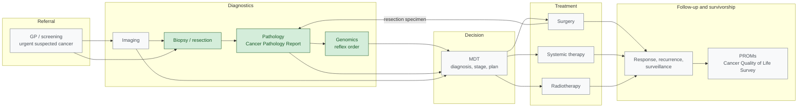

<b>Proof of concept.</b> This implementation guide is a demonstration only. It is
<b>not</b> an authoritative source, is not endorsed by NHS England, the National
Disease Registration Service or HL7, and must not be used for implementation or
clinical purposes. The authoritative source for COSD Pathology is the
<a href="https://nhsd-proxy.openprescribing.net/ndrs/data/data-sets/cosd/cosd-pathology-user-guide-v5.0/core---pathology">COSD Pathology User Guide</a>.

This page places the [Cancer Pathology Report](PathologyReport.html) in the
**whole cancer pathway**, from referral to survivorship. This guide covers the
**diagnostic** part of the pathway - pathology, and how it meets imaging and
genomics. Treatment, follow-up and patient-reported outcomes are shown for
context only: they are **out of scope**, and the national datasets and FHIR
patterns that cover them are listed so readers know where to look.

### Overview

Green: covered by this guide. Grey: context only. Surgery produces a **resection
specimen**, which goes back to pathology for a further report - often restaging
the cancer (pTNM, or ypTNM after neoadjuvant therapy).

### Pathway Stages

| Stage | What happens | In this guide | Workflow |
|---|---|---|---|
| Referral | Urgent suspected cancer referral, or a positive screening result | Context | - |
| Imaging | Lesion found; clinical staging (cTNM); image-guided biopsy | Context | [Imaging and Radiology](Imaging.html) |
| Biopsy / resection | Specimen taken and sent to histopathology with a request | **In scope** | [LTW](LTW.html) LAB-1 |
| Pathology | Diagnosis, grade, pathological stage, IHC; Cancer Pathology Report | **In scope** | [LTW](LTW.html) LAB-3 |
| Genomics | Reflex order from pathology; genomic report | **In scope** (as the pathology report's consumer) | [ILW](ILW.html), [Genomic Testing and Reporting](Genomics.html) |
| MDT | Imaging, pathology and genomic results combined; diagnosis, integrated stage and treatment plan | Context | - |
| Treatment | Surgery, systemic anti-cancer therapy, radiotherapy | Out of scope | - |
| Follow-up | Response to treatment, recurrence, surveillance | Out of scope | - |
| Outcomes | Patient-reported outcomes (PROMs) and experience (PREMs) | Out of scope | - |
{:.grid}

### Timing Standards

The NHS cancer waiting time standards, in force since
[1 October 2023](https://www.england.nhs.uk/wp-content/uploads/2023/08/PRN00654ii-changes-to-cancer-waiting-times-standards-from-1-october-2023-letter.pdf),
measure the pathway from referral:

| Standard | From | To | Relevance to pathology |
|---|---|---|---|
| Faster Diagnosis Standard (28 days) | Urgent referral | Cancer diagnosed or ruled out | Pathology is usually what confirms the diagnosis |
| 31 days | Decision to treat | First treatment | - |
| 62 days | Urgent suspected cancer referral, urgent screening referral or consultant upgrade | First treatment | Includes the diagnostic pathway, and any reflex genomic testing needed for the treatment decision |
{:.grid}

The [National Cancer Plan for England](https://www.gov.uk/government/collections/national-cancer-plan-for-england)
(February 2026) adds an ambition that 98% of histopathology tests are reported
within 10 days by March 2029, and that every patient who could benefit is offered
a test of their cancer's DNA - both directly affecting the diagnostic part of the
pathway.

### Outside this Guide

Where each later stage of the pathway is defined. The national datasets are
collected by the National Disease Registration Service (NDRS); the FHIR patterns
are from [mCODE](https://hl7.org/fhir/us/mcode/), which this guide is aligned with.

| Stage | National dataset | FHIR pattern (mCODE) |
|---|---|---|
| MDT and integrated stage | COSD (core and site-specific) | [Primary Cancer Condition](https://hl7.org/fhir/us/mcode/StructureDefinition-mcode-primary-cancer-condition.html), [TNM Stage Group](https://hl7.org/fhir/us/mcode/StructureDefinition-mcode-tnm-stage-group.html) |
| Surgery | COSD, [Hospital Episode Statistics](https://digital.nhs.uk/data-and-information/data-tools-and-services/data-services/hospital-episode-statistics) | [Cancer-Related Surgical Procedure](https://hl7.org/fhir/us/mcode/StructureDefinition-mcode-cancer-related-surgical-procedure.html) |
| Systemic anti-cancer therapy | [Systemic Anti-Cancer Therapy (SACT) data set](https://digital.nhs.uk/ndrs/data/data-sets/sact) | [Cancer-Related Medication Request](https://hl7.org/fhir/us/mcode/StructureDefinition-mcode-cancer-related-medication-request.html) / [Administration](https://hl7.org/fhir/us/mcode/StructureDefinition-mcode-cancer-related-medication-administration.html) |
| Radiotherapy | [Radiotherapy Data Set (RTDS)](https://digital.nhs.uk/ndrs/data/data-sets/rtds) | [Radiotherapy Course Summary](https://hl7.org/fhir/us/mcode/StructureDefinition-mcode-radiotherapy-course-summary.html) |
| Response and recurrence | COSD | [Cancer Disease Status](https://hl7.org/fhir/us/mcode/StructureDefinition-mcode-cancer-disease-status.html) |
| Patient-reported outcomes | [Cancer Quality of Life Survey](https://nhsd-proxy.openprescribing.net/ndrs/data/data-outputs/cancer-data-hub/cancer-quality-of-life-survey) | `Questionnaire` / `QuestionnaireResponse` |
| Patient experience | [National Cancer Patient Experience Survey (CPES)](https://www.ncpes.co.uk/) | - |
{:.grid}

### Operational Tracking (FDP Cancer 360)

Managing patients through the pathway - who is waiting, at which stage, and
against which waiting time standard - is done by cancer tracking teams. The NHS
Federated Data Platform (FDP) product **Cancer 360** brings data from different
systems into a single, automatically updated tracking list of patients on a
cancer diagnosis pathway
([Digital Health, February 2025](https://www.digitalhealth.net/2025/02/cancer-diagnostic-pathway-tool-to-launch-on-fdp/)).

The FDP Canonical Data Model overlaps with this guide in **pathway tracking and
identifiers**, not in the clinical content of the report (see the NW GMSA
[FDP Canonical Data Model](https://github.com/nw-gmsa/nw-gmsa-use-cases/blob/main/FDPCanonicalDataModel.md)
analysis):

| Area | FDP Canonical Data Model | This guide |
|---|---|---|
| Pathway | `Cancer Pathway`, `Patient Pathway`, cancer tracking comments | [Cancer Pathway](CancerPathway.html) (context) |
| MDT | `Mdt Meeting`, `Mdt Note` | Context |
| Diagnosis | `Patient Diagnosis` (SNOMED CT, ICD-10) | pCR0810, pCR6410, pCR6420 |
| Report | `Histology` - one object per discipline | [Cancer Pathology Diagnostic Report](StructureDefinition-CancerPathologyDiagnosticReport.html) |
| Results | `Test Result` - one flat row per result; no LOINC, no order object | Coded `Observation`s grouped by the report |
| Identifiers | `Test Result.Laboratory Number` | `Specimen.accessionIdentifier`, order numbers |
{:.grid}

The COSD synoptic content - histological type and grade, pTNM, margins, invasion,
tumour size, MMR IHC - has no equivalent in the FDP Canonical Data Model. What
tracking needs from the pathology report is the **milestone** (report authorised,
`DiagnosticReport.issued`, pCR0780), the diagnosis it confirms, and the
identifiers that link it to the patient's pathway.

### Patient-Reported Outcomes

PROMs are not a single step at the end of the pathway:

- **National PROMs** - the
  [Cancer Quality of Life Survey](https://england.nhs.uk/wp-content/uploads/2021/11/Cancer-quality-of-life-survey-summary-report-first-data-release.pdf),
  run by NHS England with NDRS, invites people about **18 months after diagnosis**
  to complete the EQ-5D and EORTC QLQ-C30 questionnaires. Patients are identified
  from the cancer registration data, and results are analysed by tumour site and
  stage - so the diagnosis details in the Cancer Pathology Report (diagnosis date,
  site, morphology, stage) reach PROMs **through the registry**, not through any
  exchange defined in this guide.
- **Clinical PROMs** - some services collect symptom and toxicity reports from
  patients during and after treatment, as part of their care. These are exchanges
  between the patient and the care team, with no pathology content.
