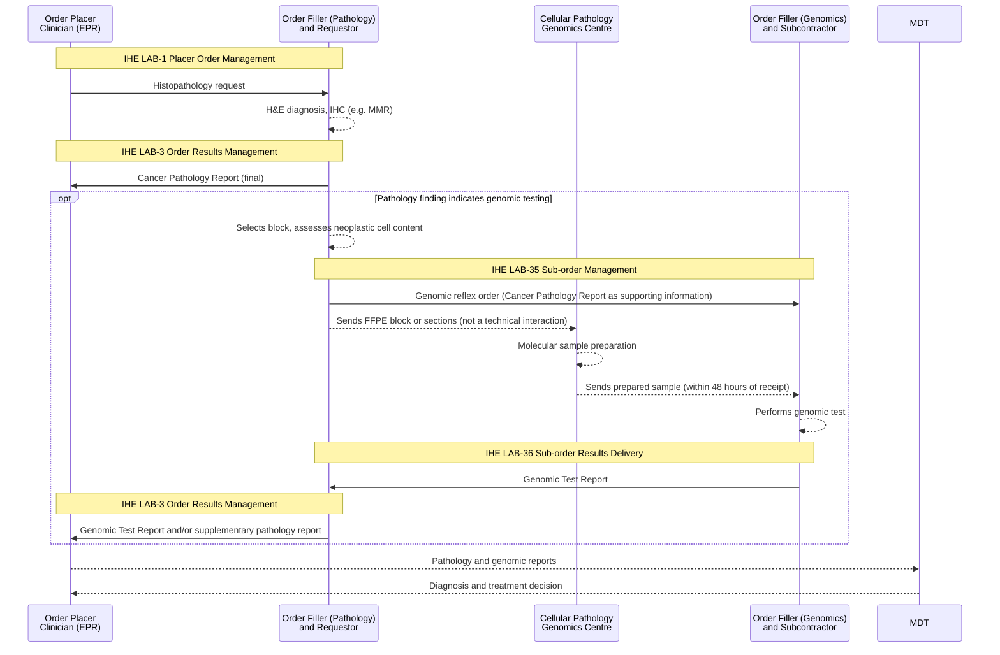

<b>Proof of concept.</b> This implementation guide is a demonstration only. It is
<b>not</b> an authoritative source, is not endorsed by NHS England, the National
Disease Registration Service or HL7, and must not be used for implementation or
clinical purposes. The authoritative source for COSD Pathology is the
<a href="https://nhsd-proxy.openprescribing.net/ndrs/data/data-sets/cosd/cosd-pathology-user-guide-v5.0/core---pathology">COSD Pathology User Guide</a>.

This page describes how **genomic testing and reporting** relate to the
[Cancer Pathology Report](PathologyReport.html). Genomics is the main downstream
user of the report: the
[Pathology to Genomics Reflex](https://github.com/nw-gmsa/nw-gmsa-use-cases/blob/main/PathologyToGenomicsReflex.md)
use case uses it as the pathology report semantics of a reflex order. The reflex
order and the genomic report follow the
[Inter-Laboratory Workflow (ILW)](ILW.html), with the pathology laboratory as
**Requestor** and the Genomic Laboratory Hub (GLH) as **Subcontractor**.

### References

- [Pathology to Genomics Reflex](https://github.com/nw-gmsa/nw-gmsa-use-cases/blob/main/PathologyToGenomicsReflex.md) - the use case this guide supports
- [NHS North West Genomics IG - Inter Laboratory Workflow (ILW)](https://nw-gmsa.github.io/en/ILW.html)
- [NHS North West Genomics IG - Genomic Test Report](https://nw-gmsa.github.io/en/Questionnaire-GenomicTestReport.html)
- [Greater Manchester Cellular Pathology Genomics Centre](https://mft.nhs.uk/the-trust/other-departments/laboratory-medicine/histopathology/cellular-pathology-genomics-centre-external/) - Manchester University NHS Foundation Trust
- [National Genomic Test Directory](https://www.england.nhs.uk/publication/national-genomic-test-directories/)
- [NICE DG27 Molecular testing strategies for Lynch syndrome in people with colorectal cancer](https://www.nice.org.uk/guidance/dg27)

### Overview

### The Pathology Report Triggers the Genomic Order

Pathology makes the diagnosis on an H&E section, and often performs
immunohistochemistry (IHC). The IHC result is usually what **triggers** the reflex
order:

| Cancer | Done in pathology first | Reflexed to genomics |
|---|---|---|
| Colorectal / endometrial | Mismatch repair (MMR) IHC - MLH1, PMS2, MSH2, MSH6 (pCR7020-7050) | If MMR deficient: BRAF and MLH1 promoter methylation (Lynch syndrome screening) |
| Lung (non-small cell) | IHC to confirm subtype (e.g. TTF-1) | Tumour gene panel (e.g. M4.14) |
{:.grid}

Which tests each pathology laboratory does itself, and which it sends to genomics,
varies locally.

### The Pathology Report as Supporting Information (LAB-35)

The reflex order names a National Genomic Test Directory test (`ServiceRequest.code`)
and the specimen (block or sample number). The pathology report gives the
**clinical evidence** for the test:

| Pathology report content | COSD | Used by genomics for |
|---|---|---|
| Tumour site (topography) and laterality | pCR6410, pCR0820 | Test eligibility, national order form |
| Morphology | pCR6420 | Test eligibility, interpretation |
| Grade of differentiation | pCR0860 | Clinical context |
| Diagnosis (ICD-10) | pCR0810 | Clinical indication |
| MMR IHC results | pCR7020-7050 | The trigger for Lynch screening reflex |
| Report text (PDF) | pCR1020 | GLH forms ask for a copy of the histopathology report |
{:.grid}

In FHIR the report goes in `ServiceRequest.supportingInfo` - either the
[Cancer Pathology Diagnostic Report](StructureDefinition-CancerPathologyDiagnosticReport.html)
with its coded results, or a reference to it. Whether the whole report is sent,
or a reference that genomics can query, is still **open** in the use case.

### Sample Preparation: Cellular Pathology Genomics Centre

In Greater Manchester the block does not go straight from the pathology
laboratory to the NW GLH. The
[Greater Manchester Cellular Pathology Genomics Centre](https://mft.nhs.uk/the-trust/other-departments/laboratory-medicine/histopathology/cellular-pathology-genomics-centre-external/)
(GM CPGC), run by Manchester University NHS Foundation Trust at Oxford Road,
provides **molecular sample preparation for solid tumours** (not haematological
cancers) for pathology departments in Greater Manchester, including Royal Oldham,
Salford Royal, Royal Bolton, Royal Manchester Children's Hospital, Wythenshawe and
Oxford Road. Its stated turnaround is less than 48 hours from receipt to dispatch
to the NW GLH.

- The GM CPGC prepares the sample but does not perform or report the genomic test,
  so it is not an Order Filler for the genomic order.
- The block (or sections) moves pathology laboratory → GM CPGC → NW GLH, while the
  reflex order (LAB-35) and the genomic report (LAB-36) are between the pathology
  laboratory and the NW GLH.
- **Open:** whether the GM CPGC is a step in the order workflow - for example
  tracking specimen receipt and dispatch (`Task` or HL7 v2 `OML_O21` status
  updates), or creating derived samples (`Specimen.parent`) - or only a physical
  step outside the information exchange.

### Genomic Results Coming Back (LAB-36 and LAB-3)

- Genomics returns its **Genomic Test Report** to pathology (LAB-36). Its content is
  defined in the NW Genomics IG
  ([Genomic Test Report](https://nw-gmsa.github.io/en/Questionnaire-GenomicTestReport.html)),
  not in this guide.
- Pathology passes it on to the clinician (LAB-3). The genomic result may also be
  added to the pathology report as a **supplementary report** - status `appended`,
  or a separate addendum report (LOINC `35265-8`) - see
  [Report Updates](LTW.html#report-updates-lab-3).
- **Open:** whether pathology passes the genomic report on, or genomics also sends
  it to the original clinician directly (HL7 v2 `OBR-28` Result Copies To is not
  mapped yet).

Both reports refer to the same specimen (block or accession number) and the same
cancer (`PrimaryCancerCondition`), which links them at the MDT.

### Not Reflex Orders

- **Germline testing** - for example R210 (inherited MMR deficiency) when Lynch
  syndrome is still possible after the tumour tests. This is a new clinician order,
  with consent and a blood sample, following the
  [Laboratory Testing Workflow (LTW)](LTW.html) to genomics.
- **Orchestrated orders** - a specialty service (for example haemato-oncology)
  places separate pathology and genomic orders and produces a combined report.

### Gaps

| Item | Why it matters | Status in this guide |
|---|---|---|
| Neoplastic (tumour) cell content % | Says whether the block is suitable for genomic testing; assessed per block | Not in COSD core - out of scope. Belongs with the specimen or the order |
| IHC other than MMR (e.g. lung markers) | Triggers other reflex orders | Not in COSD core - out of scope |
| Requesting clinician of the reflex order | The pathologist placing the order and the original clinician differ | Open in the use case |
{:.grid}
