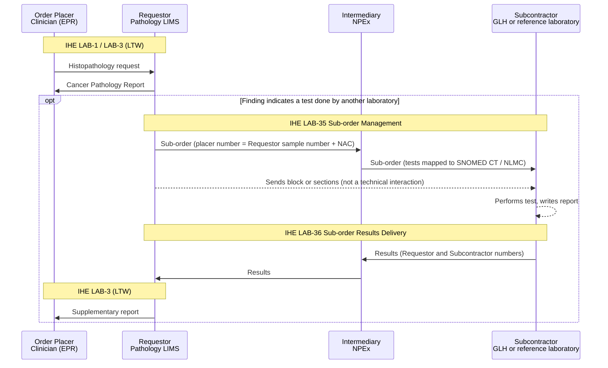
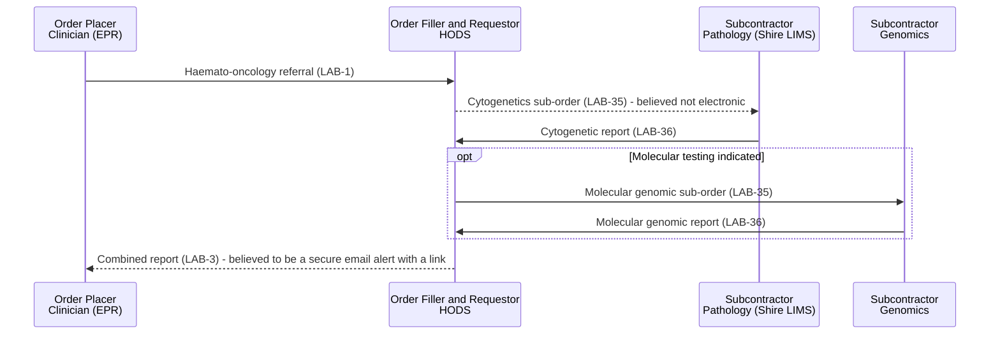

<b>Proof of concept.</b> This implementation guide is a demonstration only. It is
<b>not</b> an authoritative source, is not endorsed by NHS England, the National
Disease Registration Service or HL7, and must not be used for implementation or
clinical purposes. The authoritative source for COSD Pathology is the
<a href="https://nhsd-proxy.openprescribing.net/ndrs/data/data-sets/cosd/cosd-pathology-user-guide-v5.0/core---pathology">COSD Pathology User Guide</a>.

This page describes how the [Cancer Pathology Report](PathologyReport.html) fits
the [IHE Inter-Laboratory Workflow (ILW)](https://wiki.ihe.net/index.php/Inter_Laboratory_Workflow)
profile: a laboratory as **Requestor** placing a sub-order with another laboratory
(the **Subcontractor**) - for example a reflex order to genomics - sending the
pathology report as supporting information, and receiving the Subcontractor's
results.

See the NHS North West Genomics IG [Inter Laboratory Workflow (ILW)](https://nw-gmsa.github.io/en/ILW.html)
for the equivalent genomics page.

### References

- [IHE PaLM Technical Framework, Volume 1](https://profiles.ihe.net/PaLM/TF/Volume1/index.html) - Inter-Laboratory Workflow (ILW)
- [NHS North West Genomics IG - Inter Laboratory Workflow (ILW)](https://nw-gmsa.github.io/en/ILW.html)
- [Pathology to Genomics Reflex](https://github.com/nw-gmsa/nw-gmsa-use-cases/blob/main/PathologyToGenomicsReflex.md) - NW GMSA use case
- [Haemato-Oncology Diagnostic Pathway](https://github.com/nw-gmsa/nw-gmsa-use-cases/blob/main/HaematoOncologyPathway.md) - NW GMSA use case (HODS)
- [Order Hierarchy - ServiceRequest and Task: National Pathology Exchange (NPEx)](https://github.com/nw-gmsa/nw-gmsa-use-cases/blob/main/OrderHierarchyServiceRequestAndTask.md#national-pathology-exchange-npex) - NW GMSA use case
- [NHS England Digital - Pathology diagnostic pillar](https://digital.nhs.uk/cyber-and-data-security/guidance-and-resources/network-segmentation/pathology/pathology-diagnostic-pillar/) - NPEx

### Overview

ILW applies whenever the laboratory that received the original order sends part
of the work to **another laboratory**. For cancer pathology there are three
patterns:

| Pattern | Requestor | Subcontractor | Example |
|---|---|---|---|
| **Reflex order** | Pathology laboratory | Genomic Laboratory Hub (GLH) | MMR deficiency on IHC → BRAF and MLH1 methylation; NSCLC → tumour gene panel. See [Genomic Testing and Reporting](Genomics.html) |
| **Pathology referral** | Pathology laboratory | Another pathology laboratory | A specialist IHC test (for example MMR IHC) or a second opinion, done at a regional centre |
| **Orchestrated order** | Specialist diagnostic service | Pathology and genomics laboratories | Haemato-oncology: [HODS](#orchestrated-orders-hods) orchestrates cytogenetics and molecular genomics, and produces a combined report |
{:.grid}

Tests done **within** the pathology laboratory - IHC on its own stainers, or
in-house molecular tests - are not ILW; see
[Internal Tests](LTW.html#internal-tests-ihc-and-in-house-molecular). The boundary
is organisational, not technical.

### Actors and Transactions

| Actor | Summary |
|---|---|
| Requestor | The laboratory placing the sub-order. In LTW it is the Order Filler for the original order, and becomes the Order Placer of the sub-order |
| Subcontractor | The laboratory performing the sub-order (Order Filler of the sub-order) |
| Intermediary | A hub or integration engine between Requestor and Subcontractor - for laboratory-to-laboratory referrals, typically [NPEx](#npex-national-pathology-exchange) |
{:.grid}

| Transaction | From | To | Content |
|---|---|---|---|
| [Sub-order Management [LAB-35]](LAB-35.html) | Requestor | Subcontractor | Sub-order, with the [Cancer Pathology Report](PathologyReport.html) as supporting information. HL7 v2 `OML_O21` or FHIR `ServiceRequest` (`intent` = `reflex-order`, `basedOn` the original order) |
| [Sub-order Results Delivery [LAB-36]](LAB-36.html) | Subcontractor | Requestor | Sub-order results - for example a Genomic Test Report. HL7 v2 `ORU_R01` or FHIR `DiagnosticReport` |
{:.grid}

The Requestor then returns the results to the original Order Placer as a further
LAB-3 - see [Report Updates](LTW.html#report-updates-lab-3).

### Sub-orders (LAB-35 and LAB-36)

The Intermediary is optional: a sub-order can also go directly, or through a
regional integration engine.

### NPEx (National Pathology Exchange)

NPEx is the existing national hub for **laboratory-to-laboratory referrals**: one
laboratory sends a test request to another, and the results come back
electronically. It was developed by X-Lab (now marketed as Labgnostic), started
in the Greater Manchester Pathology Network in 2009, and connects about half of
UK NHS laboratories. In ILW terms it is an **Intermediary** between Requestor and
Subcontractor.

What is understood about NPEx, from the NW GMSA
[Order Hierarchy](https://github.com/nw-gmsa/nw-gmsa-use-cases/blob/main/OrderHierarchyServiceRequestAndTask.md#national-pathology-exchange-npex)
use case:

| Behaviour | Status |
|---|---|
| Carries test requests (orders) and results between laboratories | Confirmed |
| Message translation hub using HL7 | Confirmed - HL7 version and message types not published |
| The Requestor's sample number, made unique with the trust's National Administrative Code (NAC), is the sub-order's order number | Confirmed (vendor/trust presentation) |
| Results carry both the Requestor's and the Subcontractor's numbers | Confirmed (vendor/trust presentation) |
| Tests mapped between laboratories to SNOMED CT / NLMC, without changing local LIMS coding | Confirmed (vendor/trust presentation) |
| Messages equivalent to LAB-35 / LAB-36 (`OML^O21` or `ORM^O01`, and `ORU^R01`) | Believed |
| Carries the original clinical order number (`ORC-4` or `ORC-8`) | Not known |
| Used for the pathology → genomics reflex order in the North West | Believed, not confirmed |
| Carries the Cancer Pathology Report as supporting information | Not known |
{:.grid}

No NPEx interface specification is published. The open items need confirming
with Labgnostic, NHS England or an NPEx-connected laboratory.

### Orchestrated Orders (HODS)

At Manchester University NHS Foundation Trust, haemato-oncology referrals go to
**HODS** - both the diagnostic service and the name of its computer system. As
described in the NW GMSA
[Haemato-Oncology Diagnostic Pathway](https://github.com/nw-gmsa/nw-gmsa-use-cases/blob/main/HaematoOncologyPathway.md):

- HODS is the **Order Filler** for the clinician's referral (LAB-1) and the
  **Requestor** for two sub-orders: cytogenetics to the pathology laboratory
  (Shire LIMS), then, if indicated, molecular genomics to the genomics laboratory.
- It brings the results together into a single **combined report** to the
  referring clinician (LAB-3).
- Only the cytogenetics report from Shire to HODS (LAB-36, HL7 v2 `ORU_R01`) is
  confirmed electronic today.

HODS covers haematological cancers, not solid tumours, but it is the existing
regional example of a combined pathology and genomic report. Whether an
equivalent exists for solid tumours is **open**.

### Security Considerations

As for the NW Genomics [ILW](https://nw-gmsa.github.io/en/ILW.html) and
[LTW](LTW.html#security-considerations).
