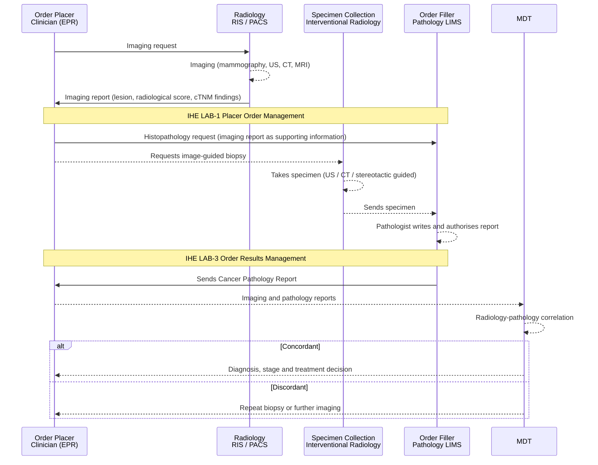

<b>Proof of concept.</b> This implementation guide is a demonstration only. It is
<b>not</b> an authoritative source, is not endorsed by NHS England, the National
Disease Registration Service or HL7, and must not be used for implementation or
clinical purposes. The authoritative source for COSD Pathology is the
<a href="https://nhsd-proxy.openprescribing.net/ndrs/data/data-sets/cosd/cosd-pathology-user-guide-v5.0/core---pathology">COSD Pathology User Guide</a>.

This page describes how **imaging and radiology** relate to the
[Cancer Pathology Report](PathologyReport.html). Radiology has its own workflow
(for example IHE Radiology Scheduled Workflow) and its own report - a separate
imaging `DiagnosticReport` - so it is **not** part of the
[Laboratory Testing Workflow (LTW)](LTW.html). Imaging and pathology meet at four
points: before the specimen is taken, at staging, at the MDT, and in imaging of
the specimen itself.

### References

- [HL7 Europe Imaging Report](https://hl7.eu/fhir/imaging/en/) (1.0.0-ballot, STU 1 ballot) - FHIR model of the imaging study report in the European context, aligned with IHE RAD and IHE MADO; the imaging counterpart of [HL7 Europe Laboratory Report](https://hl7.eu/fhir/laboratory/), which this guide is based on
- [National Imaging Registry (NIR)](https://digital.nhs.uk/services/national-imaging-registry) - NHS England service for finding and retrieving a patient's diagnostic imaging and reports held by other organisations in England, for direct care. Data stays with the originating organisation. See also the [roadmap](https://digital.nhs.uk/services/national-imaging-registry/national-imaging-registry-roadmap) and [API](https://digital.nhs.uk/developer/api-catalogue/national-imaging-registry-api) (FHIR, IHE XCA/XDS, DICOMweb)

### Overview

### Before Pathology: Detection and Image-Guided Biopsy

- Imaging usually **finds the lesion** before any specimen exists.
- Many biopsies are **image-guided** (ultrasound or CT guided core biopsy,
  stereotactic breast biopsy), so **interventional radiology** acts as a
  specimen collection actor alongside endoscopy and theatre.
- The imaging findings - lesion site, size on imaging, radiological suspicion
  score - are useful **clinical information on the request** (LAB-1). In FHIR the
  imaging report can be referenced from `ServiceRequest.supportingInfo`; its
  content is defined by [HL7 Europe Imaging Report](https://hl7.eu/fhir/imaging/en/),
  not by this guide.

### Staging: Clinical and Pathological

| Stage | Source | In this guide |
|---|---|---|
| Clinical (cTNM) | Mostly imaging (CT, MRI, PET-CT), plus examination and endoscopy | Out of scope |
| Pathological (pTNM, ypTNM after neoadjuvant therapy) | Pathology report | pCR0910-0940, see [Profiles](profiles.html) |
| Integrated stage | MDT, combining both | Out of scope |
{:.grid}

COSD records imaging in its own Imaging section, not in Core - Pathology. In FHIR,
`PrimaryCancerCondition.evidence` and `stage.assessment` can reference both the
pathology and the imaging reports; this belongs to the condition, not to the
pathology report.

### Radiology-Pathology Correlation

The MDT checks that the pathology agrees with the imaging. For example in breast,
the core biopsy category (B1-B5) is compared with the imaging scores (R, U or M
1-5). A discordant result can lead to a repeat biopsy - a new LAB-1 and LAB-3 - or
further imaging. Correlation happens at the MDT, outside both LTW and the
radiology workflow.

Prior imaging from other organisations - for example when a patient was imaged at
one hospital and is discussed at another trust's MDT - can be found and retrieved
through the NHS England [National Imaging Registry](https://digital.nhs.uk/services/national-imaging-registry).
NHS England lists pathology as a possible future diagnostic area for the registry.

### Imaging of the Specimen

- **Specimen radiography** (for example of a breast excision) confirms that the
  target lesion or calcification is in the specimen and helps assess margins. It
  is done in radiology or theatre, and can inform the gross description.
- **Digital pathology** (whole slide imaging, DICOM WSI) is pathology imaging, not
  radiology, and is covered by the IHE PaLM digital pathology profiles. It changes
  how slides are viewed, not the content of the report.

### Out of Scope

- The radiology report and its content
- Clinical (cTNM) and integrated staging
- Radiology workflow (ordering, scheduling and reporting of imaging)
