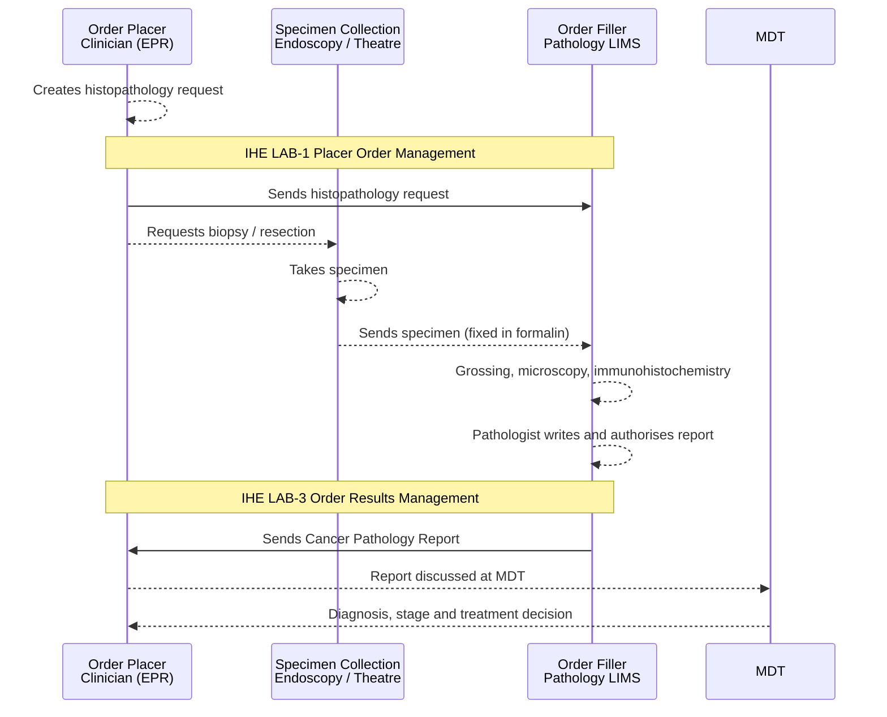
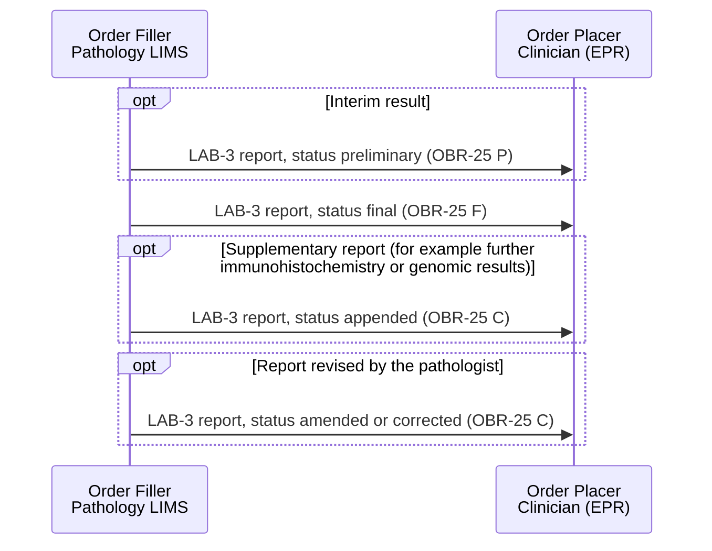
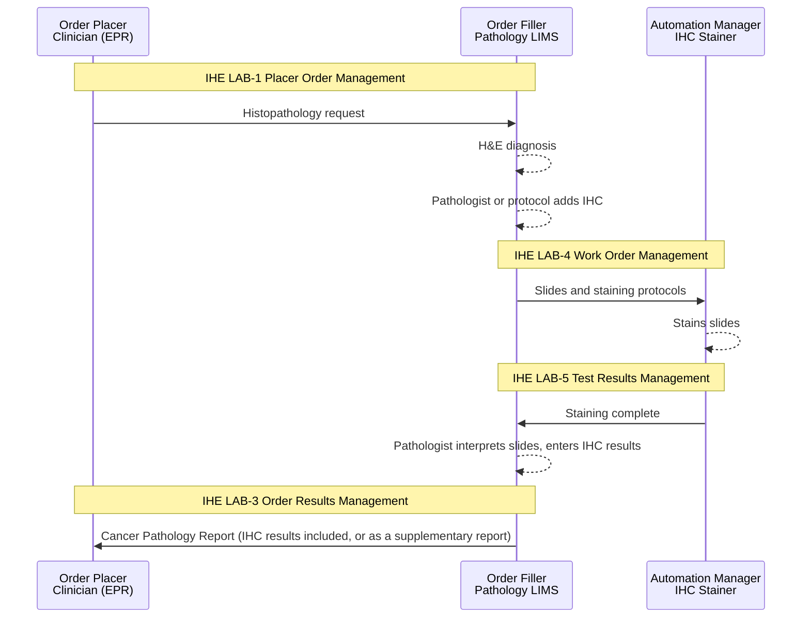

<b>Proof of concept.</b> This implementation guide is a demonstration only. It is
<b>not</b> an authoritative source, is not endorsed by NHS England, the National
Disease Registration Service or HL7, and must not be used for implementation or
clinical purposes. The authoritative source for COSD Pathology is the
<a href="https://nhsd-proxy.openprescribing.net/ndrs/data/data-sets/cosd/cosd-pathology-user-guide-v5.0/core---pathology">COSD Pathology User Guide</a>.

This page describes how the [Cancer Pathology Report](PathologyReport.html) fits
the [IHE Laboratory Testing Workflow (LTW)](https://wiki.ihe.net/index.php/Laboratory_Testing_Workflow)
profile: the pathology laboratory as **Order Filler** returning the report to the
**Order Placer** (the requesting clinician's EPR or order communications system).

See the NHS North West Genomics IG [Laboratory Testing Workflow (LTW)](https://nw-gmsa.github.io/en/LTW.html)
for the equivalent genomics page.

### References

- [IHE PaLM Technical Framework, Volume 1](https://profiles.ihe.net/PaLM/TF/Volume1/index.html) - Laboratory Testing Workflow (LTW)
- [NHS North West Genomics IG - Laboratory Testing Workflow (LTW)](https://nw-gmsa.github.io/en/LTW.html)
- [Computerised cancer histopathology reporting, data recording and downloading to cancer registries](https://rcpath.org/asset/60CB744E%2D30CF%2D40A9%2D88327F33C0206493) - Royal College of Pathologists, Working Group on Cancer Services (September 2015) - minimum LIMS requirements for cancer histopathology reporting

### Overview

#### Clinical Process

The cancer pathology report is produced at the **diagnosis** point of the cancer
pathway:

1. The patient is referred (for example an urgent suspected cancer referral, or
   from screening) and has diagnostic tests.
2. A tissue specimen is taken - a biopsy, or a resection at surgery - and sent to
   histopathology with a request.
3. The pathologist examines the specimen (gross description, microscopy, and
   immunohistochemistry where needed) and writes a report using the Royal College
   of Pathologists dataset for the cancer site, which COSD Pathology is aligned with.
4. The report goes back to the requesting clinician, and is discussed at the
   **multidisciplinary team (MDT)** meeting, where diagnosis, stage and grade drive
   the treatment decision.

A patient usually has more than one report: a diagnostic biopsy, then a resection
(which often restages the cancer, for example pTNM or ypTNM after neoadjuvant
therapy), plus supplementary reports and addenda.

#### Diagnostic Testing

The pathology laboratory may itself request further testing - for example a
reflex order to a Genomic Laboratory Hub. This is covered by the
[Inter-Laboratory Workflow (ILW)](ILW.html), not LTW - see
[Genomic Testing and Reporting](Genomics.html).

Imaging usually comes before the specimen (detection and image-guided biopsy) and
is combined with the pathology report at the MDT - see
[Imaging and Radiology](Imaging.html).

### Actors and Transactions

| Actor | Summary |
|---|---|
| Order Placer | EPR or Order Communications System of the requesting clinician (for example the surgical, endoscopy or oncology team) |
| Order Filler | Pathology laboratory information management system (LIMS) |
| Order Result Tracker | Usually provided by the EPR; receives and displays the report, and makes it available to the MDT |
| Automation Manager | Software that drives laboratory instruments - here the automated IHC stainers - often part of the LIMS or vendor middleware |
| Intermediary | Regional or Trust integration engine |
{:.grid}

| Transaction | From | To | Content |
|---|---|---|---|
| [Placer Order Management [LAB-1]](LAB-1.html) | Order Placer | Order Filler | Histopathology request. HL7 v2 `OML_O21` or FHIR `ServiceRequest` |
| [Order Results Management [LAB-3]](LAB-3.html) | Order Filler | Order Placer / Order Result Tracker | [Cancer Pathology Report](PathologyReport.html). HL7 v2 `ORU_R01` or FHIR [Cancer Pathology Diagnostic Report](StructureDefinition-CancerPathologyDiagnosticReport.html) |
| Work Order Management [LAB-4] | Order Filler | Automation Manager | Slides and staining protocols for IHC. Internal to the laboratory - see [Internal Tests](#internal-tests-ihc-and-in-house-molecular) |
| Test Results Management [LAB-5] | Automation Manager | Order Filler | Staining status (the result itself is entered by the pathologist). Internal to the laboratory |
{:.grid}

#### Order Filler (LIMS) Requirements

The Royal College of Pathologists has published
[minimum requirements for LIMS](https://rcpath.org/asset/60CB744E%2D30CF%2D40A9%2D88327F33C0206493)
used to report cancer histopathology, for commissioners and suppliers. Those
relevant to producing and exchanging the Cancer Pathology Report:

| # | RCPath requirement (summarised) | In this guide |
|---|---|---|
| 3 | Direct entry of reporting data items using proformas or templates with pick-lists, plus free text | Coded results from the [Terminology](terminology.html) value sets |
| 4 | Link a patient's current and previous requests and reports | A patient usually has several reports - see [Clinical Process](#clinical-process) |
| 5 | Reports contain all RCPath dataset items, and support providing the COSD pathology items to the cancer registry | [Pathology Report](StructureDefinition-PathologyReport.html) logical model of COSD Pathology |
| 6 | Coded information recorded using SNOMED CT | Topography and morphology (pCR6410, pCR6420) |
| 7 | Uniform, standard units (for example all distances in millimetres) | [Tumor Size](StructureDefinition-TumorSize.html) |
| 8 | A final authorised report in electronic and printed form; **supplementary reports** for information that becomes available later - after MDT discussion, further investigations such as immunohistochemistry and molecular genetics, and external opinions | `presentedForm`; [Report Updates](#report-updates-lab-3) and [Internal Tests](#internal-tests-ihc-and-in-house-molecular) |
| 9 | **Full text and synoptic report from the same data entry**, with the synoptic content transferable to a database | `DiagnosticReport.presentedForm` alongside the coded `DiagnosticReport.result` |
| 10 | Audit trail of changes to authorised reports | `amended` / `corrected` reports; `AuditEvent` - see [Security Considerations](#security-considerations) |
| 11 | Derived fields calculated from entered data (for example final pTNM stage) | [TNM Stage Group](StructureDefinition-TNMStageGroup.html) |
| 12 | Data items and reports transmitted electronically, using agreed protocols, to local clinical systems, cancer networks and cancer registries | [LAB-3](LAB-3.html) to the Order Placer. Registry submission is out of scope |
| 15 | Desirable: store and link images and complex external reports, such as molecular pathology | Genomic Test Report (LAB-36) - see [Genomic Testing and Reporting](Genomics.html) |
{:.grid}

The requirements date from 2015, when COSD pathology submission became mandatory
(1 January 2016). They define what the LIMS must capture, not how it is exchanged:
whether a LIMS can send the synoptic content as coded `OBX` segments or FHIR
`Observation`s, rather than only report text or a PDF, needs to be checked with
each supplier.

### Laboratory Order and Report (LAB-1 and LAB-3)

The [Cancer Pathology Report](PathologyReport.html) is **optional** in its link to
the order (`DiagnosticReport.basedOn`): many histopathology requests are still made
on paper, so the LIMS may not hold an electronic order to reference.

#### Report Updates (LAB-3)

A cancer pathology report is often sent more than once for the same specimen.
Each update is a further LAB-3 for the same report, using
`DiagnosticReport.status` (HL7 v2 `OBR-25`):

Supplementary reports may also be sent as a separate addendum report (LOINC
`35265-8`, see [LAB-3](LAB-3.html)) that references the original.

### Internal Tests (IHC and In-house Molecular)

Immunohistochemistry (IHC) - for example the mismatch repair (MMR) proteins MLH1,
PMS2, MSH2 and MSH6, or Ki-67 - is a **sub-test within the histopathology request**,
not a separate order. The clinician usually does not order it: the pathologist
adds it, or a local protocol requires it (for example MMR IHC on every colorectal
cancer).

- Sections are cut from the formalin-fixed paraffin-embedded (FFPE) block onto
  slides, one slide per antibody.
- The LIMS sends the slides and staining protocols to an **automated stainer**
  (LAB-4), which reports back staining status (LAB-5).
- The stainer does **not** produce the result. The pathologist interprets the
  stained slide, under the microscope or on screen (digital pathology), and enters
  the result - for example "MLH1 lost" or "Ki-67 30%".

Some pathology departments also do molecular tests in-house (for example MSI by
PCR, or BRAF). These are internal tests in the same way. Only tests sent to
**another laboratory**, such as a Genomic Laboratory Hub, are sub-orders under the
[Inter-Laboratory Workflow (ILW)](ILW.html) - the boundary is organisational, not
technical.

In the report:

- IHC results are `Observation`s in the same `DiagnosticReport.result`, using the
  [Tumor Marker Test](StructureDefinition-TumorMarkerTest.html) profile (HL7 v2: `OBX`
  segments in the same `ORU_R01`).
- When IHC results come after the main report, they are sent as a supplementary
  report - see [Report Updates](#report-updates-lab-3). In HL7 v2, tests added by the
  laboratory can be flagged with `OBR-11` Specimen Action Code `A` (add-on).
- An internal add-on can be represented as a child `ServiceRequest` (`basedOn` the
  histopathology request), but it does not need to be exchanged.
- Strictly, an IHC result belongs to a **slide** cut from a **block** taken from the
  specimen (`Specimen.parent`). The
  [Cancer Pathology Specimen](StructureDefinition-CancerPathologySpecimen.html)
  profile does not yet model blocks or slides.

### Security Considerations

As for the NW Genomics [LTW](https://nw-gmsa.github.io/en/LTW.html): OAuth2 for
FHIR APIs, audit using `AuditEvent` (IHE BALP), and TLS for all exchanges.

### Cross-Profile Considerations

Patient demographic and encounter updates (HL7 v2 ADT events such as A08, A31 and
A40 merge) apply to the report as for any other laboratory result. Registry
submission to NDRS (monthly COSD XML) is out of scope for this guide.
