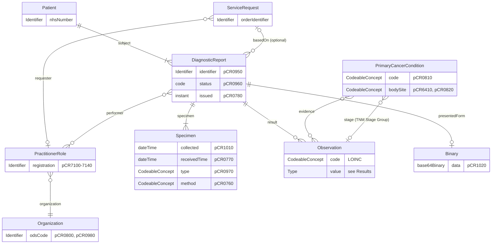
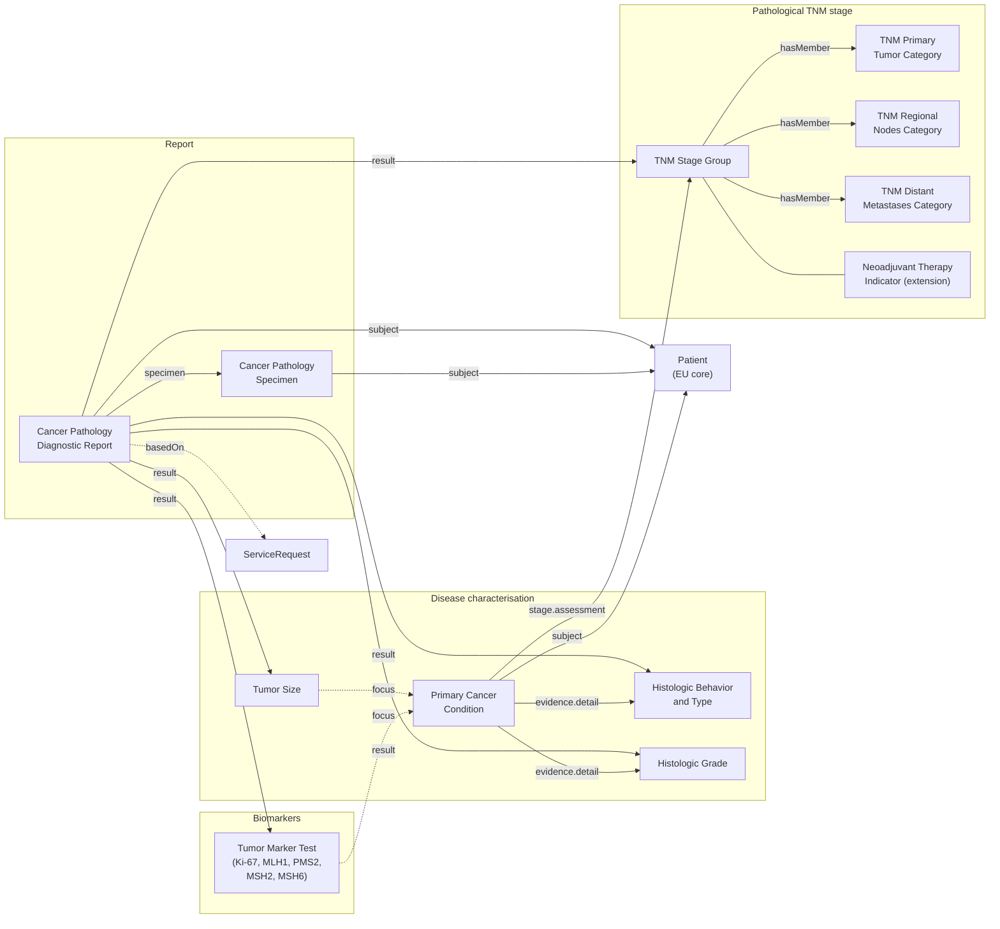
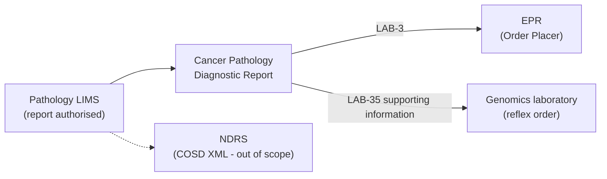

<b>Proof of concept.</b> This implementation guide is a demonstration only. It is
<b>not</b> an authoritative source, is not endorsed by NHS England, the National
Disease Registration Service or HL7, and must not be used for implementation or
clinical purposes. The authoritative source for COSD Pathology is the
<a href="https://nhsd-proxy.openprescribing.net/ndrs/data/data-sets/cosd/cosd-pathology-user-guide-v5.0/core---pathology">COSD Pathology User Guide</a>.

This page describes the common requirement for a **Cancer Pathology Report**: the
structured content a pathology laboratory reports for a cancer specimen, based on
[COSD Pathology](https://nhsd-proxy.openprescribing.net/ndrs/data/data-sets/cosd/cosd-pathology-user-guide-v5.0/core---pathology)
(v5) **Core - Pathology**. Unlike the NW Genomics
[Genomic Test Report](https://nw-gmsa.github.io/en/Questionnaire-GenomicTestReport.html),
it is not modelled as a Questionnaire. The content is defined by the
[Pathology Report logical model](StructureDefinition-PathologyReport.html), and
exchanged using the [profiles](profiles.html) in this guide.

The report has the same basic shape as other diagnostic reports - patient,
order, report, specimen and results - with the cancer-specific content in the
results.

### References

- [COSD Pathology User Guide v5 - Core Pathology](https://nhsd-proxy.openprescribing.net/ndrs/data/data-sets/cosd/cosd-pathology-user-guide-v5.0/core---pathology) - National Disease Registration Service (primary source of requirements)
- [Royal College of Pathologists cancer datasets](https://www.rcpath.org/profession/guidelines/cancer-datasets-and-tissue-pathways.html) - COSD Pathology v5 is aligned with these
- [HL7 Europe Laboratory Report](https://hl7.eu/fhir/laboratory/) (HL7 FHIR) - base profiles
- [HL7 Europe Base](https://hl7.eu/fhir/base/) (HL7 FHIR) - base profiles
- [HL7 Europe Common Cancer Model](https://build.fhir.org/ig/hl7-eu/cancer-common/) - cancer diagnosis model
- [mCODE (minimal Common Oncology Data Elements)](https://hl7.org/fhir/us/mcode/) STU4 (HL7 FHIR) - profile alignment
- [HL7 US Cancer Pathology Data Sharing](https://hl7.org/fhir/us/cancer-reporting/index.html) (HL7 FHIR) - pathology report pattern
- [HL7 Lab Results Interface (LRI)](https://www.hl7.org/implement/standards/product_brief.cfm?product_id=279) (HL7 v2.5.1) - `ORU_R01` mappings (indicative)

### Domain Archetype

A **level 2** (field-level) view of the cancer pathology report, showing the
FHIR resources it uses and their key attributes. Each attribute is labelled with
its COSD Pathology data item.

`ServiceRequest` is **optional** (`basedOn`): it is only present when the report
answers an order the reporting system knows about.

**Structured and unstructured.** As for any laboratory report, the coded results
(`DiagnosticReport.result`) sit alongside the full human-readable report
(`DiagnosticReport.presentedForm`, typically a PDF) - COSD Pathology Report Text
(pCR1020). The coded results support computer processing and onward use, such as
a reflex order to genomics; the PDF remains the report clinicians read. For
document sharing (for example IHE XDS/MHD), see the Document Perspective of
[HL7 Europe Laboratory Report](https://hl7.eu/fhir/laboratory/).

### Detailed Model

Cardinalities are from the [logical model](StructureDefinition-PathologyReport.html).
HL7 v2 mappings are **indicative**.

#### Patient

<b>HL7 FHIR Profile:</b> <a href="http://hl7.eu/fhir/base/StructureDefinition/patient-eu-core">Patient (EU core)</a>

| Name | COSD | Value Set / Data Type | Cardinality | HL7 v2 ORU_R01 | HL7 FHIR |
|---|---|---|---|---|---|
| NHS Number | - | Identifier | 1..1 | PID-3 | Patient.identifier |
{:.grid}

COSD Pathology core identifies the patient through the COSD submission record, not
the pathology items, so no patient items are listed here.

#### Diagnostic Workflow

<b>HL7 FHIR Profile:</b> <a href="StructureDefinition-CancerPathologyDiagnosticReport.html">Cancer Pathology Diagnostic Report</a>

| Name | COSD | Value Set / Data Type | Cardinality | HL7 v2 ORU_R01 | HL7 FHIR |
|---|---|---|---|---|---|
| Service Report Identifier | pCR0950 | Identifier | 0..1 | OBR-3 | DiagnosticReport.identifier |
| Pathology Observation Report Identifier | pCR6220 | Identifier | 0..1 | OBR-3 (local) | DiagnosticReport.identifier |
| Service Report Status | pCR0960 | [COSD Service Report Status](ValueSet-cosd-service-report-status.html) | 1..1 | OBR-25 | DiagnosticReport.status (FHIR status; COSD code by mapping) |
| Investigation Result Date | pCR0780 | date | 0..1 | OBR-22 | DiagnosticReport.issued |
| Pathology Report Text | pCR1020 | string / Attachment | 0..1 | OBX (type ED or TX) | DiagnosticReport.presentedForm |
| Consultant (Pathology Test Requested By) | pCR7100 / pCR7120 | Identifier (e.g. GMC) | 0..1 | OBR-16 | ServiceRequest.requester (PractitionerRole) |
| Organisation Site Identifier (Pathology Test Requested By) | pCR0980 | Identifier (ODS site code) | 0..1 | ORC-21 | ServiceRequest.requester (PractitionerRole).organization |
| Consultant (Pathologist) | pCR7130 / pCR7140 | Identifier (e.g. GMC) | 0..1 | OBR-32 | DiagnosticReport.performer (PractitionerRole) |
| Organisation Identifier (Reporting Pathologist) | pCR0800 | Identifier (ODS code) | 1..1 | OBX-23 | DiagnosticReport.performer (Organization) |
{:.grid}

#### Specimen

<b>HL7 FHIR Profile:</b> <a href="StructureDefinition-CancerPathologySpecimen.html">Cancer Pathology Specimen</a> (mCODE Human Specimen)

| Name | COSD | Value Set / Data Type | Cardinality | HL7 v2 ORU_R01 | HL7 FHIR |
|---|---|---|---|---|---|
| Sample Collection Date | pCR1010 | date | 0..1 | SPM-17 | Specimen.collection.collectedDateTime |
| Sample Receipt Date | pCR0770 | date | 0..1 | SPM-18 | Specimen.receivedTime |
| Specimen Nature | pCR0970 | [COSD Specimen Nature](ValueSet-cosd-specimen-nature.html) | 1..1 | SPM-4 | Specimen.type |
| Pathology Investigation Type | pCR0760 | [COSD Pathology Investigation Type](ValueSet-cosd-pathology-investigation-type.html) | 1..1 | SPM-7 | Specimen.collection.method |
{:.grid}

#### Diagnosis

<b>HL7 FHIR Profile:</b> <a href="StructureDefinition-PrimaryCancerCondition.html">Primary Cancer Condition</a> and <a href="StructureDefinition-HistologicBehaviorAndType.html">Histologic Behavior and Type</a>

| Name | COSD | Value Set / Data Type | Cardinality | HL7 v2 ORU_R01 | HL7 FHIR |
|---|---|---|---|---|---|
| SNOMED Version (Pathology) | pCR6990 | [COSD SNOMED Version](ValueSet-cosd-snomed-version.html) | 1..1 | - | Implied by the coding system version |
| Topography (SNOMED) Pathology | pCR6410 | [Cancer Topography](ValueSet-cancer-topography.html) | 0..* | OBX | Condition.bodySite |
| Morphology (SNOMED) Pathology | pCR6420 | [Cancer Morphology](ValueSet-cancer-morphology.html) | 0..* | OBX | Histologic Behavior and Type: Observation.valueCodeableConcept |
| Diagnosis (ICD Pathological) | pCR0810 | [Cancer Diagnosis](ValueSet-cancer-diagnosis.html) | 0..* | OBX | Condition.code |
| Tumour Laterality (Pathological) | pCR0820 | [COSD Tumour Laterality](ValueSet-cosd-tumour-laterality.html) | 1..1 | OBX | Condition.bodySite (laterality qualifier) |
{:.grid}

At least one topography or morphology code is required.

#### Tumour

| Name | COSD | Value Set / Data Type | Cardinality | HL7 v2 ORU_R01 | HL7 FHIR |
|---|---|---|---|---|---|
| Lesion Size (Pathological) | pCR0830 | Quantity (mm) | 0..1 | OBX | [Tumor Size](StructureDefinition-TumorSize.html) |
| Grade of Differentiation (Pathological) | pCR0860 | [COSD Grade of Differentiation](ValueSet-cosd-grade-of-differentiation.html) | 1..1 | OBX | [Histologic Grade](StructureDefinition-HistologicGrade.html) |
| Cancer Vascular or Lymphatic Invasion | pCR0870 | [COSD Cancer Vascular or Lymphatic Invasion](ValueSet-cosd-vascular-or-lymphatic-invasion.html) | 1..1 | OBX | Observation (no mCODE profile) |
| Perineural Invasion | pCR1100 | [COSD Perineural Invasion](ValueSet-cosd-perineural-invasion.html) | 1..1 | OBX | Observation (no mCODE profile) |
| Excision Margin | pCR0880 | [COSD Excision Margin](ValueSet-cosd-excision-margin.html) | 1..1 | OBX | Observation (no mCODE profile) |
| Excision Margin (Circumferential) | pCR1150 | [COSD Excision Margin (Circumferential)](ValueSet-cosd-circumferential-margin.html) | 1..1 | OBX | Observation (no mCODE profile) |
| Synchronous Tumour Indicator | pCR0840 | [COSD Synchronous Tumour Indicator](ValueSet-cosd-synchronous-tumour-indicator.html) | 1..1 | OBX | Observation (no mCODE profile) |
{:.grid}

#### Lymph Nodes

| Name | COSD | Value Set / Data Type | Cardinality | HL7 v2 ORU_R01 | HL7 FHIR |
|---|---|---|---|---|---|
| Number of Nodes Examined | pCR0890 | integer | 0..1 | OBX | Observation (no mCODE profile) |
| Number of Nodes Positive | pCR0900 | integer | 0..1 | OBX | Observation (no mCODE profile) |
| Sentinel Lymph Nodes Examined Number | pCR1110 | integer | 0..1 | OBX | Observation (no mCODE profile) |
| Sentinel Lymph Nodes Positive Number | pCR1120 | integer | 0..1 | OBX | Observation (no mCODE profile) |
| Post SLNB Completion Lymphadenectomy - Nodes Examined Number | pCR1130 | integer | 0..1 | OBX | Observation (no mCODE profile) |
| Post SLNB Completion Lymphadenectomy - Nodes Positive Number | pCR1140 | integer | 0..1 | OBX | Observation (no mCODE profile) |
{:.grid}

#### Pathological TNM Stage

| Name | COSD | Value Set / Data Type | Cardinality | HL7 v2 ORU_R01 | HL7 FHIR |
|---|---|---|---|---|---|
| TNM Coding Edition | pCR6980 | [COSD TNM Coding Edition](ValueSet-cosd-tnm-coding-edition.html) | 1..1 | OBX | Observation.method on each TNM profile |
| TNM Version Number (Pathological) | pCR6820 | string | 0..1 | OBX | Observation.method on each TNM profile |
| T Category (Pathological) | pCR0910 | CodeableConcept | 0..1 | OBX | [TNM Primary Tumor Category](StructureDefinition-TNMPrimaryTumorCategory.html) |
| N Category (Pathological) | pCR0920 | CodeableConcept | 0..1 | OBX | [TNM Regional Nodes Category](StructureDefinition-TNMRegionalNodesCategory.html) |
| M Category (Pathological) | pCR0930 | CodeableConcept | 0..1 | OBX | [TNM Distant Metastases Category](StructureDefinition-TNMDistantMetastasesCategory.html) |
| TNM Stage Grouping (Pathological) | pCR0940 | CodeableConcept | 0..1 | OBX | [TNM Stage Group](StructureDefinition-TNMStageGroup.html) |
| Neoadjuvant Therapy Indicator | pCR1000 | [COSD Neoadjuvant Therapy Indicator](ValueSet-cosd-neoadjuvant-therapy-indicator.html) | 1..1 | OBX | [Neoadjuvant Therapy Indicator](StructureDefinition-NeoadjuvantTherapyIndicator.html) extension on TNM Stage Group |
{:.grid}

#### Biomarkers

<b>HL7 FHIR Profile:</b> <a href="StructureDefinition-TumorMarkerTest.html">Tumor Marker Test</a>

| Name | COSD | Value Set / Data Type | Cardinality | HL7 v2 ORU_R01 | HL7 FHIR |
|---|---|---|---|---|---|
| Ki-67 Indicator | pCR7000 | [COSD Ki-67 Indicator](ValueSet-cosd-ki67-indicator.html) | 1..1 | OBX | Tumor Marker Test, or dataAbsentReason when not done |
| Ki-67 Result | pCR7010 | Quantity (%) | 0..1 | OBX | Tumor Marker Test (LOINC 29593-1).valueQuantity |
| MLH1 Nuclear Expression Intact | pCR7020 | [COSD Nuclear Expression Intact](ValueSet-cosd-nuclear-expression-intact.html) | 1..1 | OBX | Tumor Marker Test (LOINC 81691-8) |
| PMS2 Nuclear Expression Intact | pCR7030 | [COSD Nuclear Expression Intact](ValueSet-cosd-nuclear-expression-intact.html) | 1..1 | OBX | Tumor Marker Test (LOINC 81694-2) |
| MSH2 Nuclear Expression Intact | pCR7040 | [COSD Nuclear Expression Intact](ValueSet-cosd-nuclear-expression-intact.html) | 1..1 | OBX | Tumor Marker Test (LOINC 81692-6) |
| MSH6 Nuclear Expression Intact | pCR7050 | [COSD Nuclear Expression Intact](ValueSet-cosd-nuclear-expression-intact.html) | 1..1 | OBX | Tumor Marker Test (LOINC 81693-4) |
{:.grid}

Loss of MMR nuclear expression is the trigger for the Lynch syndrome reflex order
to genomics - see [Pathology to Genomics Reflex](https://nw-gmsa.github.io/use-cases/PathologyToGenomicsReflex.html).

### Results

`DiagnosticReport.result` carries the coded findings, one Observation per item,
each with a fixed LOINC code where one exists:

| Result | Profile | Code | mCODE equivalent |
|---|---|---|---|
| Histologic type and behaviour | [Histologic Behavior and Type](StructureDefinition-HistologicBehaviorAndType.html) | LOINC `31206-6` | Histologic Behavior and Type |
| Grade | [Histologic Grade](StructureDefinition-HistologicGrade.html) | LOINC `33732-9` | Histologic Grade (NCIt `C18000`) |
| Tumour size | [Tumor Size](StructureDefinition-TumorSize.html) | LOINC `21889-1` | Tumor Size |
| pT | [TNM Primary Tumor Category](StructureDefinition-TNMPrimaryTumorCategory.html) | LOINC `21899-0` | TNM Primary Tumor Category |
| pN | [TNM Regional Nodes Category](StructureDefinition-TNMRegionalNodesCategory.html) | LOINC `21900-6` | TNM Regional Nodes Category |
| pM | [TNM Distant Metastases Category](StructureDefinition-TNMDistantMetastasesCategory.html) | LOINC `21901-4` | TNM Distant Metastases Category |
| Stage group | [TNM Stage Group](StructureDefinition-TNMStageGroup.html) | LOINC `21902-2` | TNM Stage Group |
| Ki-67, MMR IHC | [Tumor Marker Test](StructureDefinition-TumorMarkerTest.html) | [Cancer Pathology Tumor Marker Test](ValueSet-CancerPathologyTumorMarkerTest.html) | Tumor Marker Test |
| Invasion, margins, synchronous tumour, lymph nodes | `Observation-resultslab-eu-lab` | Not yet assigned | None |
{:.grid}

#### Profile relationships

How the result profiles relate to each other, the report, the specimen and the
diagnosis - in the style of the mCODE
[profile overview diagram](https://build.fhir.org/ig/HL7/fhir-mCODE-ig/). Arrow
labels are the FHIR elements that hold the reference. Every Observation also has
`subject` (Patient) and `specimen` (Cancer Pathology Specimen), which are left
off the diagram to keep it readable. Dashed arrows are optional links used by
mCODE that the profiles here do not constrain. Click a box to open its profile.

`DiagnosticReport.result` may also reference the TNM category Observations
directly, and the COSD items with no mCODE profile (invasion, margins,
synchronous tumour, lymph nodes) as plain `Observation-resultslab-eu-lab` results.

#### Report flow

### Examples

<b>TODO</b> - no examples yet. A colorectal cancer example with MMR loss (Lynch
syndrome screening) is planned.

