This is for information/analysis purposes only and is not a planned piece of work.

A logical model of a cancer pathology report, based only on the
[COSD Pathology](https://nhsd-proxy.openprescribing.net/ndrs/data/data-sets/cosd/cosd-pathology-user-guide-v5.0/core---pathology)
(v5) **Core - Pathology** section. It is not a FHIR profile and is not exchanged
as is. The **Mappings** tab gives the COSD data item (`pCR` code) for each element,
and an indicative FHIR mapping.

It is used as the pathology report semantics in the
[Pathology to Genomics Reflex](https://nw-gmsa.github.io/use-cases/PathologyToGenomicsReflex.html)
use case. Items genomics also needs but COSD does not cover, such as neoplastic
cell content and the reflex order itself, are not in this model.

### Entity relationship diagram

```mermaid
erDiagram
    PATHOLOGY_REPORT ||--o| REQUESTED_BY : "requested by"
    PATHOLOGY_REPORT ||--|| REPORTED_BY : "reported by"
    PATHOLOGY_REPORT ||--|| SPECIMEN : "reports on"
    PATHOLOGY_REPORT ||--|| DIAGNOSIS : "records"
    PATHOLOGY_REPORT ||--|| TUMOUR : "describes"
    PATHOLOGY_REPORT ||--o| LYMPH_NODES : "assesses"
    PATHOLOGY_REPORT ||--o| TNM_STAGE : "stages"
    PATHOLOGY_REPORT ||--o| KI67 : "biomarker"
    PATHOLOGY_REPORT ||--o| MMR_IHC : "biomarker"

    PATHOLOGY_REPORT {
        Identifier reportIdentifier "pCR0950"
        Identifier observationReportIdentifier "pCR6220"
        code reportStatus "pCR0960"
        date investigationResultDate "pCR0780"
        string reportText "pCR1020"
    }
    REQUESTED_BY {
        Identifier consultant "pCR7100 / pCR7120"
        Identifier organisationSite "pCR0980"
    }
    REPORTED_BY {
        Identifier pathologist "pCR7130 / pCR7140"
        Identifier organisation "pCR0800"
    }
    SPECIMEN {
        date collectionDate "pCR1010"
        date receiptDate "pCR0770"
        code specimenNature "pCR0970"
        code investigationType "pCR0760"
    }
    DIAGNOSIS {
        code snomedVersion "pCR6990"
        SNOMED topography "pCR6410 (0..*)"
        SNOMED morphology "pCR6420 (0..*)"
        ICD10 icdDiagnosis "pCR0810 (0..*)"
    }
    TUMOUR {
        code laterality "pCR0820"
        Quantity lesionSize "pCR0830 mm"
        code grade "pCR0860"
        code vascularOrLymphaticInvasion "pCR0870"
        code perineuralInvasion "pCR1100"
        code excisionMargin "pCR0880"
        code circumferentialMargin "pCR1150"
        code synchronousTumour "pCR0840"
    }
    LYMPH_NODES {
        integer examined "pCR0890"
        integer positive "pCR0900"
        integer sentinelExamined "pCR1110"
        integer sentinelPositive "pCR1120"
        integer completionExamined "pCR1130"
        integer completionPositive "pCR1140"
    }
    TNM_STAGE {
        code codingEdition "pCR6980"
        string version "pCR6820"
        code t "pCR0910"
        code n "pCR0920"
        code m "pCR0930"
        code stageGrouping "pCR0940"
        code neoadjuvantTherapy "pCR1000"
    }
    KI67 {
        code indicator "pCR7000"
        Quantity result "pCR7010 %"
    }
    MMR_IHC {
        code mlh1 "pCR7020"
        code pms2 "pCR7030"
        code msh2 "pCR7040"
        code msh6 "pCR7050"
    }
```

In COSD itself the report is a flat record, one per specimen report. The
groupings above are added to make the model easier to read.

### Terminology

| Items | Coding | FHIR value set available? |
|---|---|---|
| Topography (`pCR6410`), Morphology (`pCR6420`) | SNOMED, version given by `pCR6990`. Only SNOMED CT is licensed for new data since April 2017; older data may hold SNOMED II/3/RT T and M codes | No published COSD value set. SNOMED CT can be used directly as hierarchies: body structure for topography, morphologically abnormal structure for morphology. FHIR core [SNOMED CT Body Structures](http://hl7.org/fhir/R4/valueset-body-site.html) covers topography |
| Diagnosis (`pCR0810`) | ICD-10 | ICD-10 code system; no COSD value set |
| Report status, specimen nature, investigation type, laterality, grade, invasion, margins, TNM edition, Ki-67 indicator, MMR results | NHS Data Dictionary national codes, listed in the COSD Pathology user guide | No - not published as FHIR CodeSystems or ValueSets that we have found |
| TNM categories (`pCR0910`-`pCR0940`) | UICC/AJCC/ENETS text values | No - TNM is licensed; SNOMED CT has TNM concepts |
{:.grid}
